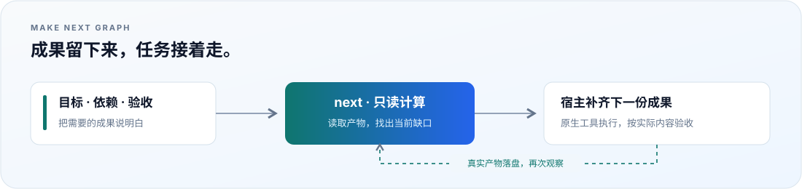
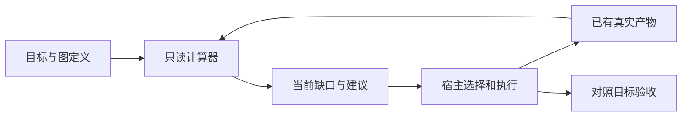

<div align="center">

# Make Next Graph

**把长任务变成可检查、可复用、可接续的成果。**

[](#开始体验)
[](LICENSE)
[](docs/verification.md)

[快速上手](docs/guides/quickstart.md) · [独立使用](docs/guides/standalone.md) · [搭配方法](docs/guides/composition.md) · [收益与证据](docs/benefits.md)



</div>

Make Next Graph 是一个轻量 Agent Skill：**从目标倒推产物依赖，每次读取真实文件，找出下一份有价值的成果。**
它可以单独处理调研、报告和内容任务，也可以与 Goal、规格驱动开发（SDD）、测试驱动开发（TDD）一起使用。

## 为什么使用

| 你遇到的情况 | 它提供的帮助 |
|---|---|
| 换一次对话就要重新梳理任务 | 根据当前目标、图和已有成果接手。 |
| 收集过的资料又被重复采集 | 复用仍有效的快照与分析，补实际缺口。 |
| 成果很多，却看不清还差什么 | 把缺失产物、未知证据和阻塞依赖分开列出。 |
| 不同工作可以同时推进 | 提供依赖独立的候选，由宿主分配输出和执行。 |
| 想加入某个行业的专业判断 | 增加该行业的中间产物、验收与检查。 |

这些能力已有本地实测；总体提速比例、token 节省和质量提升幅度仍需真实业务对照。
见[收益现象与测量方法](docs/benefits.md)。

## 开始体验

需要 **Node.js 22+**。下面的离线示范不需要安装依赖、模型 Key 或联网；它演示产物接续，实际使用 skill 时由你现有的 agent 执行和判断。

从本仓库根目录运行，首次体验请使用新的输出目录：

```sh
# 保存明确标记的合成快照
node examples/web-digest/run.mjs --fixture --root .work/quickstart --until snapshot

# 查看此时可独立推进的 ranking、coverage
node skills/make-next-graph/scripts/make.mjs next .work/quickstart/graph.json --json

# 换一次进程继续，生成摘要、真实检查和交付入口
node examples/web-digest/run.mjs --fixture --root .work/quickstart
```

查看 `.work/quickstart/digest.md` 和 `delivery.md`；`checks/verify.json` 保留实际进程输出。
想使用官方公开 API：去掉 `--fixture`，并换成新的目录，例如 `.work/live-edition`。

→ [完整上手步骤与预期结果](docs/guides/quickstart.md)

## 作为 skill 使用

将 **[skills/make-next-graph](skills/make-next-graph) 整个目录**放到宿主支持的 skills 位置并加载。
保留 `scripts/`、`references/`、`assets/` 和许可证；安装位置与调用方式沿用宿主文档。
支持 `$skill` 调用的宿主可以这样开始：

```text
使用 $make-next-graph 完成这个目标：[写下结果与验收条件]。
先读现有资料，复用有效成果，建立最小有用依赖图，按真实结果继续。
```

采用 [Agent Skills 目录格式](https://agentskills.io/specification)。辅助工具只依赖 Node.js 内置模块；
方法不绑定模型供应商、特定宿主或其他 skill。没有 Node 时，也可以按入口说明人工判断相同依赖。

## 如何运行



**图无运行台账，成果有持久内容。** `next` 只读；`evidence-ready` 表示引用的文件与预期进程结果具备，业务验收由 agent 或人完成。

## 单独使用，也能组合

| 方式 | 用在什么地方 | 从哪里开始 |
|---|---|---|
| make 独立使用 | 调研、比较、文档、内容生产 | [独立使用手册](docs/guides/standalone.md) |
| Goal + make | 按目标接续，复用已有成果 | [接续与并行手册](docs/guides/resume-parallel.md) |
| Goal + TDD + make | 小步实现可验证行为，保留真实红绿输出 | [搭配使用手册](docs/guides/composition.md) |
| Goal + SDD + TDD + make | 引用原生规格文件组织实现与验证 | [搭配使用手册](docs/guides/composition.md#引用原生-sdd-文件) |
| 行业 graph | 数据质量、受众分析、专业评审等中间产物 | [行业扩展手册](docs/guides/industry-graphs.md) |

## 文档导航

| 想了解什么 | 文档 |
|---|---|
| 第一次安装、运行和分发 | [快速上手](docs/guides/quickstart.md) |
| 用给定资料完成一个报告 | [独立使用](docs/guides/standalone.md) |
| 组合 Goal、TDD、OpenSpec、Spec Kit | [搭配使用](docs/guides/composition.md) |
| 新 agent 接手、任务变化、并行分工 | [接续与并行](docs/guides/resume-parallel.md) |
| 增加可复用的行业中间产物 | [行业扩展](docs/guides/industry-graphs.md) |
| 有什么收益、怎样观察和测量 | [收益与证据](docs/benefits.md) |

[全部文档](docs/README.md) · [运行架构](docs/runtime-architecture.md) · [交互架构图](docs/diagrams/runtime-architecture.html) · [图格式](skills/make-next-graph/references/graph-format.md)

## 验证与适用范围

```sh
npm test
npm run validate
```

当前运行代码在 Windows 上通过 Node.js 22.23.4、24.20.0 各 26 项回归，并经过独立子 agent 场景验证。
[验证记录](docs/verification.md)区分了实际结果、历史记录和未实测范围。

Linux/macOS、不同宿主自动发现及长期无人值守仍需实测。唤醒、权限、预算、竞争写入协调和外部动作重试由宿主负责。
这个工具适合有可落盘成果的任务；小到不需要中间成果的工作可以直接完成。

## 许可证

作者：[@patrickleehua](https://github.com/patrickleehua) · [MIT](LICENSE)。单独分发的 skill 目录也包含许可证。
当前为 MVP；适用范围与实测边界见[验证记录](docs/verification.md)。
