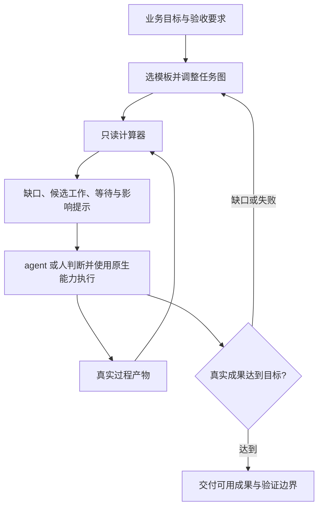

# Make Next Graph 技术设计

## 结论与输入分级

**建议采用“可移植 skill＋无状态只读计算器＋可组合产物模板”。** 节点是实际成果，
图描述依赖和产出办法，程序现算缺口，业务判断与动作交给使用它的 agent 或人。
它可以独立使用，TDD、SDD、Goal 循环和并行 agent 都是可选组合。

本文按技术架构与初版模块设计组织，面向使用者和后续贡献者。

| 分级 | 输入或结论 |
|---|---|
| 已确认需求 | 2026-10-28 的用户要求：独立公开、保留通用 make 思想、无状态产物图、可运行互联网案例、后续行业扩展、方法可组合也可单独用。 |
| 已确认公开事实 | 依赖求值、agent 持久化、规格方法和 skill 格式已有公开方案，来源见 [research.md](research.md)。 |
| 设计建议 | 用 JSON 表达图，用 Node.js 内置模块实现辅助工具；不新增模型平台或调度服务。 |
| 当前假设 | 第一版用户是已有 agent 宿主或命令行的开发者；任务产物能保存为可访问的普通文件。 |
| 验证事实 | 当前实现的运行证据及实际覆盖环境以 [verification.md](verification.md) 为准。 |

本仓库的程序、公开文案、配方和案例独立编写。公开内容仅使用通用概念和公开资料，
不以私有框架代码、内部角色清单、缺陷记录、配置或运行数据作为依赖。

## 目标、范围与选择

希望解决的问题是：长任务把上下文当唯一记忆，换进程后不知道哪些成果仍可用；
流程模板绑死行业；已有文件又容易被当成验收通过。目标是让下一步建议可解释、
成果可复用、行业知识可添加，同时保留真实失败和人的判断。

| 方案 | 适用情况 | 代价 | 本版选择 |
|---|---|---|---|
| 纯提示词方法 | 很小的任务、没有运行环境。 | 依赖关系与缺口要人工核对。 | 保留为无程序用法与退路。 |
| skill＋只读计算器 | 多份过程产物、需要接续或组合方法。 | 必须维护真实依赖，业务质量仍由 agent 判断。 | 推荐并实现。 |
| 执行型持久工作流 | 必须由服务器保证调度、重试、定时器和副作用协调。 | 需要专门运行时、持久化及运行约束。 | 由既有系统提供，可在其中调用本工具。 |

本版实现文件图观察、目标依赖闭包、缺口与影响提示、JSON 片段组合、模板实例化、
Mermaid 输出和一个真实联网示范。没有自动执行图、自动派 agent、自动失效链、
后台常驻服务、业务文本裁决或外部副作用恢复保证。

## 分层与数据流



```text
skills/make-next-graph/
  SKILL.md                    方法入口，支持手工使用
  scripts/graph.mjs           结构校验、文件观察、依赖计算、图导出
  scripts/make.mjs            validate / next / init / mermaid
  scripts/record.mjs          显式调用的原生命令输出采集器
  assets/templates/           三套模板及可组合片段
  references/                数据契约、行业扩展、方法组合、JSON Schema
examples/web-digest/          与通用计算器分开的联网案例生产者
```

方法层负责如何判断；定义层负责当前目标和依赖；观察层只读文件；计算层给建议；
执行层保留在宿主。CLI 与库共用计算逻辑。案例脚本显式执行自己的示范流程，
不成为通用 `run graph` 引擎。

## 数据契约与模块边界

完整字段见 [graph-format.md](../skills/make-next-graph/references/graph-format.md)。
图格式版本为 `1`，节点类型只有外部输入、普通产物和命令检查。

| 模块 | 输入与规则 | 输出 | 异常、权限与验收点 |
|---|---|---|---|
| 图加载与组合 | JSON 图及其目录下的片段；合并后检查唯一 ID、唯一产出者和无环依赖。 | 规范化图与拓扑顺序。 | 越界引用、未知依赖、重复或环路返回具体错误；不执行 JSON 中的命令。 |
| 文件观察 | 显式工作区根和相对普通文件路径；检查可读、非空。 | 在、缺、未知及时间信息。 | 权限错误、空文件、目录、越界软链接不能推成缺失或通过；只读。 |
| 检查观察 | 保存的真实命令 exitCode/stdout/stderr。 | 匹配预期、失败、未能验证或未知。 | 截断或格式坏报未知，超时/无退出码报未验证；程序不证明日志来源和业务覆盖。 |
| 依赖求值 | 选定目标的传递依赖闭包，结合文件观察。 | ready、waiting、attention、evidenceReady。 | 下游文件存在也不能掩盖缺失前置；不相关分支不拖住当前目标。 |
| 模板实例化 | 内置模板和新的输出文件位置。 | 可独立修改的扁平 graph.json。 | 拒绝覆盖既有图；不伪造目标、代码、日志或业务结果。 |
| 输出采集 | 用户显式指定的原生可执行文件与参数。 | 真实原始进程记录。 | 无 shell 展开；调用失败或超时不记成通过；不由 next 自动触发。 |
| 联网示范 | 官方 API 或明确标记的合成 fixture。 | 快照、两份分析、摘要、检查输出、交付入口。 | 网络失败直接交清；不静默切成离线成功；续跑复用同一目录的既有快照。 |

所有节点事实只在调用内存中存在。`graph.json` 是配方定义，不是运行数据库。
规格、代码、报告、分析和检查原始输出具有持久内容，这是无状态计算仍能接续的基础。

软件模板可用重复的 `--spec <原文件相对路径>` 绑定现有规格方法的原产物。
这是文件引用替换，不增加 SDD 适配器、状态同步或命令编排。其余路径按项目需要
在实例化的图内直接调整。简易 TDD 可沿用本来使用的验收说明和测试命令。

MVP 的具体运行验收范围见 [mvp-acceptance.md](mvp-acceptance.md)。互联网示范的
完整交付命令每次显式运行当前字节的检查；即使时间戳不变，也不会用旧绿记录
替代当前结果。这个示范生产者的验证选择不改变通用计算器的只读建议边界。

## 变化、判断与返修

上游文件比下游新时，提示“可能受影响”；间接下游也收到提示。已有成果不被删除，
可用性不因时间提示自动改变。图定义、内容语义或保留时间戳的编辑不能靠此机制可靠
识别，主会话需要读实际变化。这项限制来自避免误伤有效成果的取舍。

检查失败的建议是调查失败并修复根因。主会话可修改实现、补缺失来源、调整错误依赖，
然后做相关验证。纯文本评审由主会话读，不使用关键词猜通过；处理意见可作为普通
中间产物。只按实质影响复核，不为了补形式而反复跑全链。

当程序有错时，保留错误信息，修图或按目标和原始成果继续工作。必要依赖、用户暂停、
实际失败和宿主权限仍然有效。降级不等于把失败当作已验收。

## 行业扩展与方法组合

复用单位是“片段＋验收要求＋配方”，不是固定的行业状态机。调研片段可同时供调研
报告和内容生产使用；新增受众、数据质量或可行性计算等节点，不需要改引擎。
现有节点的修改应在实例化后的图里明确进行，片段合并不支持同名覆盖。

SDD 产物直接引用所选工具的原路径。TDD 引用真实测试与 red/green 输出；失败原因
是否有效仍由 agent 检查。Goal 决定成功标准，make 层组织产物依赖，宿主负责循环、
预算、唤醒和停止。每一层都能独立替换。

可把依赖上独立的路径交给多个原生 agent，按具体输入、输出和验收分工。无依赖边
不保证没有写入冲突，所以程序只输出候选，不发放锁、租约或并行许可。

## 长时间任务的可靠性边界

已完成数据采集不应因进程丢失重做；恢复时重读目标、定义和产物即可重算建议。
但运行时能否再次启动、暂停意图是否保留、是否重复触发外部动作，仍需宿主负责。
文件缺失不能证明外部操作没有发生。原生执行事实与幂等契约不足时，先确认那个动作，
其他独立工作可继续。

本版适合能落盘的成果型任务。不是所有工作都能完整表达为普通文件；若业务依赖
数据库、外部系统或实时条件，应由当地工具导出可读事实并保留其验证范围，或者在
已有工作流运行时里使用本工具。它不承诺任意任务“完美且无限”运行。

## 实施与验收

顺序为数据契约和示范目标 → 只读核心 → 组合模板 → 实际示范 → 失败及恢复验证。
已有目录从空目录新增全部文件，无其他系统的运行代码被替换或重构。

| 前置与操作 | 可观察预期 |
|---|---|
| 提供目标且两条独立分支缺产物，调用 next。 | 同时列出两条建议；文件和目录内容不变。 |
| 检查真实退出码不匹配，下游交付文件已存在。 | 保留失败，下游不可用，建议调查失败。 |
| 检查没退出码或文件读不到。 | 分别未验证/未知，不伪装成缺失或通过。 |
| 把上游文件时间改新。 | 提示间接影响，既有产物不自动作废。 |
| 为已有成果插入必要行业中间产物。 | 新缺口出现，已有结果仍在，依赖更新可解释。 |
| 图有环或重复产出者。 | 在观察前报具体结构错误，不执行任何配方。 |
| 联网示范停在快照，再由另一进程续跑。 | 复用原快照及其时间，产出摘要与真实退出码为 0 的检查记录。 |
| 单独复制 skill 目录运行。 | 模板、脚本和引用仍可找到，无项目私有依赖。 |

本地验证覆盖范围见验证记录。原生多 agent 协同、跨宿主长时间唤醒和行业专业质量
没有由这些程序测试自动证明。

## 风险与后续选择

| 风险或假设 | 当前处理 | 后续触发条件 |
|---|---|---|
| 文件有了但内容不合格。 | 永远不由存在性宣布业务成功；要求读验收和真实结果。 | 具体行业需要机器可判定规则时增加当地真实检查。 |
| 时间戳误报或漏报。 | 仅提示，不自动失效；人工读实质变化。 | 若某领域有精确版本契约，再提供可选领域观察器。 |
| 多 agent 写同一文件。 | 宿主安排所有权，候选列表不代表安全并行。 | 真有共享写需求时接已有隔离机制。 |
| 网络数据变化或不可用。 | 固定快照、有超时、离线模式明确标记；不静默替代。 | 数据源扩展时增加各自可复现的适配与验收。 |
| 普通文件不足以表示业务事实。 | 保留本地优先的第一版范围。 | 真实用户案例需要外部系统观察时再定义小适配器。 |

默认采用 MIT 许可证草案；本地初版可继续调整。公开仓库归属、正式包名、发布渠道
需要仓库所有者在发布时决定，不影响本地运行。尚未执行远端发布或系统级安装。
