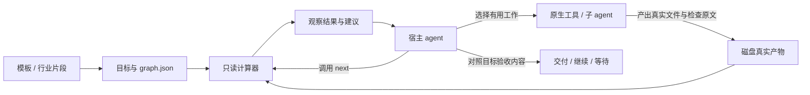
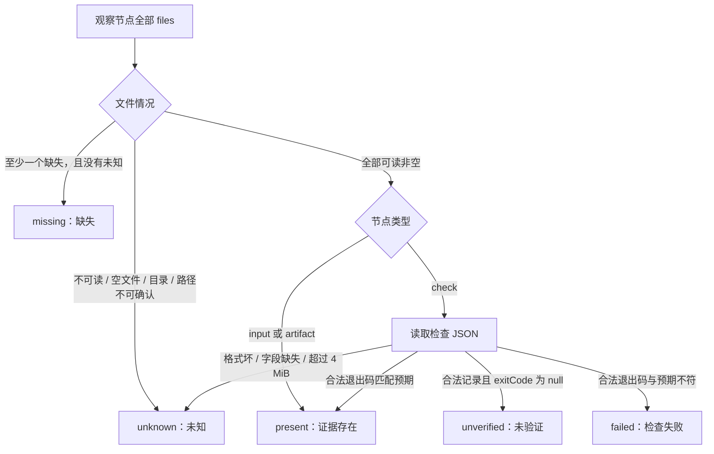
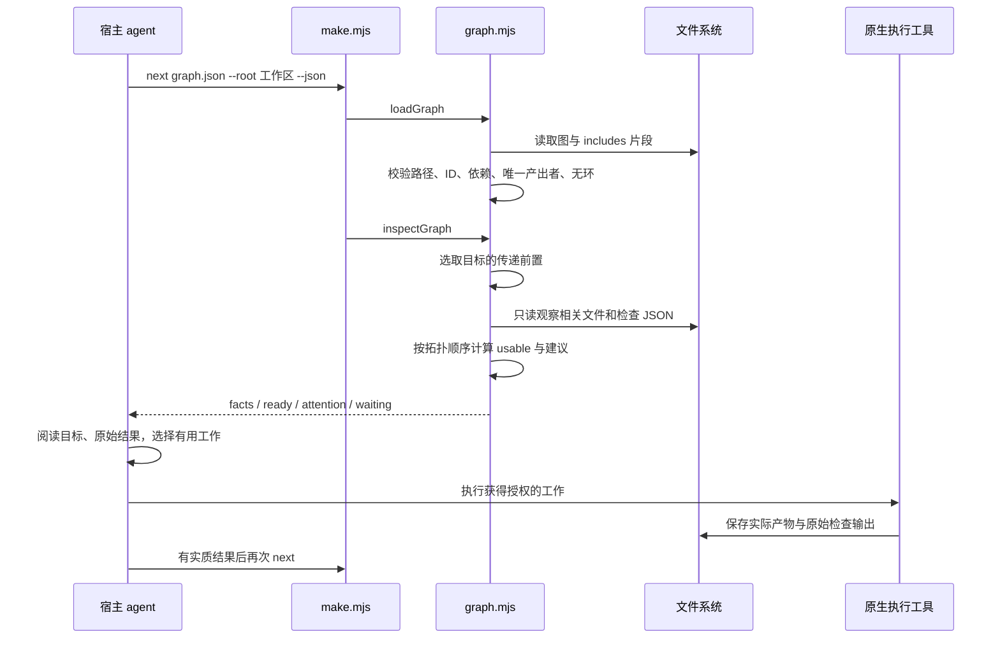
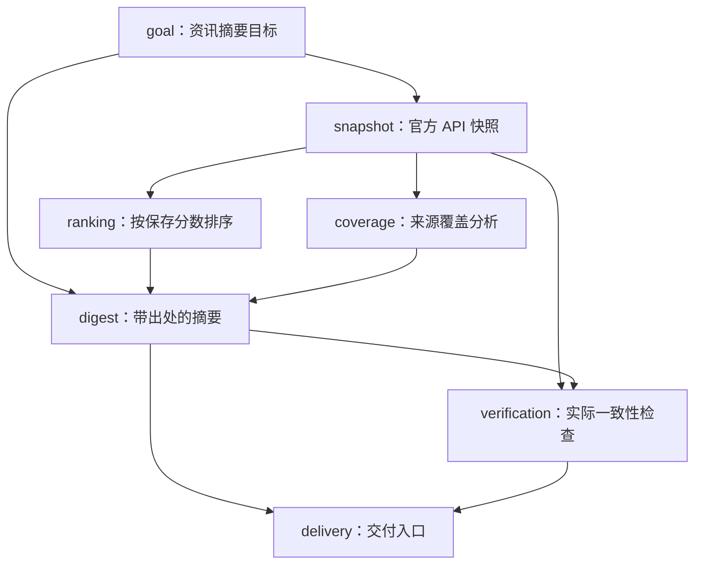
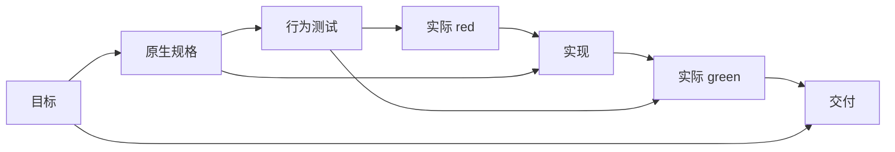

# Make Next Graph 运行架构与节点判定

当前实现的核心是：**宿主读目标并作判断，make 层重算依赖建议，原生工具产出文件，再按真实结果继续。**
图描述成果之间的关系，持久文件承载实际内容；节点事实只存在于一次调用的内存中。
本文解释现有代码，不新增执行框架或改变原有行为。

[打开交互架构图](diagrams/runtime-architecture.html)，或查看可复用的[图源定义](diagrams/runtime-architecture.json)。

## 1. 整体架构



| 层 | 负责的事 | 当前落点 |
|---|---|---|
| 目标与定义 | 说明结果、验收条件、文件路径、真实依赖。 | 用户已有目标文件、实例化的 graph.json。 |
| 复用层 | 组合通用和行业节点；保留原生规格路径。 | templates、fragments、重复的 `--spec` 选项。 |
| 计算层 | 加载校验、观察文件、计算可用性与下一步建议。 | `make.mjs`、`graph.mjs`。 |
| 宿主判断 | 读实际内容，选择值得做的工作，控制执行与停止。 | 当前使用的 agent 或人工。 |
| 原生执行 | 调工具、写代码、生成报告、运行测试、分配子 agent。 | 现有工具；可显式使用 `record.mjs` 采集进程结果。 |
| 持久产物 | 保存真实规格、输入快照、源码、报告、测试输出。 | 当前项目自己的文件系统。 |

图中的建议是一次函数调用的返回值。下一次调用重新观察，不读取另一份节点进度台账。

## 2. 三类节点

| kind | 表达什么 | 示例 | 缺失时怎么处理 |
|---|---|---|---|
| `input` | 由外部提供、当前图不负责生产的输入。 | 用户目标、客户给定资料。 | 等待实际输入；没有 recipe。 |
| `artifact` | 可以生产、查看、复用的成果。 | 快照、规格、代码、分析、草稿、评审。 | 前置可用时建议生产。 |
| `check` | 一次真实进程的原始结果。 | 测试、数据质量检查、摘要一致性检查。 | 前置可用时建议检查；结果失败则建议调查。 |

一个节点可以引用多个文件，要求全部非空、可读、为普通文件。路径显式列出，不展开目录或通配符。

## 3. 节点事实判定图

下面是**每次观察的分支**。文件变化后重新走这些分支；程序不保存状态迁移历史。



| fact | 确切含义 | 需要做的事 |
|---|---|---|
| `present` | 普通节点引用的文件可读非空；检查节点另需退出码匹配。 | 继续对照内容与验收要求。 |
| `missing` | 有文件不存在，且没有更优先的未知观察。 | 判断由本图生产还是等待外部输入。 |
| `unknown` | 空文件、目录、读失败、越界或悬空链接、检查 JSON 损坏等。 | 检查具体路径和原因。 |
| `failed` | 检查记录有整数退出码，但不匹配期待值。 | 读原始失败输出，修实际原因。 |
| `unverified` | 检查记录合法但没有观测到进程退出码。 | 保留验证缺口，解决启动、超时等条件。 |

普通文件观察只检查文件属性及是否能读取一个字节，不理解文档或代码含义。
检查记录要求 `exitCode`、字符串 `stdout` 和 `stderr`；它不能认证记录的作者或测试覆盖质量。

多个文件中同时出现未知与缺失时，节点整体先报 `unknown`，避免把读不到误当成尚未生产。

## 4. 依赖可用性和建议

节点自身有文件之后，还要结合前置依赖计算：

```text
blockedBy(n) = 直接前置中 usable 为 false 的节点
usable(n)    = 自身 fact 为 present，并且 blockedBy 为空
```

因此，现有交付文件仍可能因测试失败、输入缺失或中间成果不可用而被阻塞。

| 当前情况 | 返回的建议 |
|---|---|
| 外部 input 缺失 | `waiting`，列出要提供的输入文件。 |
| 产物缺失，全部前置可用 | `ready / produce`。 |
| 检查失败，全部前置可用 | `ready / investigate-failure`。 |
| 自身 unknown 或 unverified | `attention / inspect-evidence`。 |
| 前置不可用 | `waiting / blockedBy`。 |
| 上游可能发生影响 | `attention / assess-impact`。 |

这些列表不是互斥的节点状态。例如一个未知结果可以既需要检查证据，又在等待前置；
已有成果也可以同时出现时间影响提示。程序没有给候选工作打业务优先级或预计成本分数。

`parallelCandidates` 就是当前 `ready` 的节点 ID 列表；宿主再判断是否值得并行、是否会写同一文件。

## 5. 整个目标如何判断

按以下顺序计算本次返回值：

1. 选定目标依赖范围内有 unknown/unverified：`status = needs-attention`。
2. 否则，所有选定目标都 usable：`status = evidence-ready`。
3. 其余情况：`status = needs-work`。

`evidenceReady` 表示目标及其前置证据可用；`semanticAcceptance` 始终是 `not-evaluated`。
业务完成由宿主读内容判断。时间影响提示也可以与 `evidence-ready` 同时出现。

`ready` 为空也不直接表示完成：缺外部输入、未知证据、未能验证都可能没有可生产候选。
宿主应结合 attention、waiting、实际目标决定继续、请求所缺条件或让出执行。

**CLI 退出 0 表示这次观察成功，即使任务仍缺产物。** 自动接入时应读 JSON 的字段；
无效图或顶层 IO 错误退出 2。

## 6. 一次 next 的真实时序



文件观察使用 `Promise.all`；依赖计算按拓扑顺序执行。只观察选定目标的前置文件，
不会扫描整个仓库。整个图定义仍需合法：未选分支的结构错误也会在加载校验阶段被拒绝。

## 7. 当前互联网示范的完整依赖图

对应现有 `examples/web-digest/graph.json`，共 7 个节点：



| 节点 | 实际文件 |
|---|---|
| goal | `goal.md` |
| snapshot | `sources/snapshot.json` |
| ranking | `analysis/ranking.json` |
| coverage | `analysis/coverage.json` |
| digest | `digest.md` |
| verification | `checks/verify.json` |
| delivery | `delivery.md` |

运行到快照后，ranking/coverage 两个分析可以由不同 agent 分工；分析汇总后生成摘要，实际校验通过后交付。

快照保留来源 URL、抓取时间、所选 ID、返回元数据和 live/fixture 标记。新一期使用新目录；
同一期续跑复用已有快照。示范的完整交付入口会显式重新校验当前内容：逐篇核对标题、分数、
顺序、原文/讨论链接，以及展示覆盖数字和出处。它没有阅读文章全文或探测远端 URL 可达性。

## 8. 变更与返修怎么发生

当前时间影响提示使用：直接前置中任一文件比当前节点最旧文件新，或前置已有间接影响提示。
这一提示只在当前节点 fact 为 present 时计算，沿依赖向下传播。

它不会删除文件、自动置为失效或自动执行。保留时间戳的编辑、图配方文字变化和业务含义变化，
都需要宿主读实际内容。图因此可能证据齐备，但旧内容已经不满足新目标。

例如免运费门槛从 5000 改为 8000：

1. 宿主重读新目标，发现旧实现与测试仍沿用旧门槛。
2. 按新契约补边界断言，实际运行获得有效失败。
3. 修实现，再运行相关测试。
4. 用新的 red/green 路径保留本次输出；历史输出继续保留。
5. 必要时修改图的引用和依赖，记录 `changeReason`，对照新目标交付。

返修是宿主按真实变化作出的判断；图帮助暴露依赖缺口。

返修循环在宿主执行中发生，产物依赖仍保持无环。例如 `草稿 → 评审` 后发现问题，
宿主修改草稿、复核评审，不把评审反向加成草稿的前置。需要保留每版时，另列下一版草稿与评审。
普通评审文档即使写着“不通过”，文件事实仍可为 present；宿主必须读意见，或接该领域真实的进程检查。

## 9. Goal、SDD、TDD 如何组合

| 方法 | 给这一层提供什么 |
|---|---|
| Goal | 最终要什么、哪些约束必须满足。 |
| SDD | 选定工具已有的行为规格、设计、任务文件。 |
| TDD | 行为测试、有效的真实 red、实现、同一测试的 green。 |
| make | 把上述真实产物连成依赖，按实际文件重算缺口。 |
| 宿主 | 运行工具、内容判断、权限、预算、唤醒、并行和停止。 |

软件模板的基本依赖为：



`--spec` 替换规格节点的文件引用，直接指向 OpenSpec / Spec Kit 原文件。
它不会安装工具、执行 slash 命令、复制同义规格，或解析任务勾选来证明业务已完成。

TDD red 默认期待退出 1；语法错误和缺失行为都可能退出 1，所以宿主必须读原始断言。
starter 源文件已经存在时，计算器仍可能先建议 green；宿主应读 red 并补齐缺失行为。
普通文档任务按实际需要选择节点，可以只有目标、来源、报告。

## 10. 长任务接手与多 agent 分工

接手时所需的实际材料是：当前目标、图、已有成果、相关检查原文，以及有用的交接说明。
新 agent 重新阅读和计算，从仍有价值的成果继续；依赖图帮助它定位应该读哪些材料。

每条独立路径可以给原生 agent 一个小任务包：

```text
目标与适用约束
直接前置产物路径
唯一负责的输出路径
验收要求与必要检查
权限 / 停止条件
```

宿主分配不同输出、收回实际产物、核对内容后整合。`recipe.writes` 是写入范围提示，
图校验的唯一产出者基于 `files` 路径；这些定义不会建立文件锁或隔离共享目录。

更长时间的循环需由宿主提供。其接入过程可以是：

```text
重读目标与相关成果
  → 计算当前缺口
  → 对照内容选最有用的行动
  → 在现有授权内执行
  → 检查实质结果
  → 达标则交付；有工作则继续；无行动条件则报告具体阻塞并让出执行
```

当前 skill 不提供定时服务、自动重启、租约或后台常驻 worker。重试外部发送、付款、发布等
动作，需读取宿主的实际执行事实和操作自己的幂等契约；文件缺失不能证明外部动作未发生。

## 11. 行业中间产物怎么加入

例如现有来源分析需要补数据质量判断，可以新增一个普通 artifact：

```json
{
  "id": "data.quality",
  "title": "数据质量评估",
  "kind": "artifact",
  "files": ["analysis/data-quality.md"],
  "requires": ["research.sources"],
  "acceptance": "记录缺失项、样本偏差，以及对结论的实际影响。",
  "recipe": {
    "instructions": "阅读原数据，留下对决策有影响的质量评估。",
    "writes": ["analysis/data-quality.md"]
  }
}
```

再让报告依赖它即可；这段是插入既有研究图的节点，单独使用前仍需对应的来源节点。
现有成果保留，图会暴露新增缺口。复用时把节点放进 fragment，供模板通过 includes 组合。
组合采用增加定义，不同片段不能靠同名节点覆盖彼此；活动任务可用 init 扁平化后明确修改。

init 得到的扁平图可以独立编辑；直接使用 includes 的活动图会在下次加载时重新读片段，
因此共享片段的变更应有明确的采用决定，避免模板更新悄悄改变进行中的任务。

需要机器判定的行业标准，加入该领域自己的真实检查脚本；复杂业务知识放在产物和验收里。
当前 CLI 没有领域插件注册、任意系统状态发现或自动行业认证。

## 12. 文件、执行与边界细节

| 项目 | 当前实现 |
|---|---|
| 工作区根 | `next --root` 显式指定；默认图所在目录。产物相对路径从这里解析。 |
| includes 根 | 图入口所在目录树，最多 64 个不同 JSON 定义；相同片段重复引用去重。 |
| 节点上限 | 组合后 1–1000 个，校验唯一 ID、已知依赖、无环和唯一文件产出者。 |
| 观察路径 | 拒绝越界相对路径和不便跨平台的名字；既有越界/悬空链接保持未知。该检查不构成执行器沙箱。 |
| init | 写新图、展开片段，拒绝覆盖已有图；不会创建假产物。 |
| next | 只读，不执行 recipe 或写回节点状态。 |
| record | 显式执行原生可执行程序，无 shell 展开；保存 command、时间、退出码和原始输出。 |
| 捕获限制 | 默认 120 秒；每个输出流 256 KiB 预算，截断/启动失败/信号无真实退出码时记未验证。 |
| 记录写入 | 先写临时文件再 rename；同一路径再次捕获会替换记录，需保留历史时选新路径。 |
| 宿主权限 | 工具执行和日志输出路径仍使用现有宿主权限；recipe 文本不增加授权。 |
| 结果边界 | 文件存在与预期退出码具备；业务判断、证据来源真实性、竞争写入和外部动作恢复由当地工具/宿主负责。 |

## 13. 从哪里看代码

| 入口 | 对应实现 |
|---|---|
| 图结构与路径规则 | [graph.mjs](../skills/make-next-graph/scripts/graph.mjs) 的 `artifactPath`、`validateGraph`、`loadGraph`。 |
| 文件和检查事实 | 同文件 `safeFile`、`observeFile`、`observeNode`。 |
| 目标依赖与返回值 | 同文件 `inspectGraph`。 |
| CLI 参数与模板绑定 | [make.mjs](../skills/make-next-graph/scripts/make.mjs) 的 `main`。 |
| 原始进程记录 | [record.mjs](../skills/make-next-graph/scripts/record.mjs) 的 `capture`。 |
| 宿主使用原则 | [SKILL.md](../skills/make-next-graph/SKILL.md)。 |
| 当前互联网图与执行 | [graph.json](../examples/web-digest/graph.json)、[run.mjs](../examples/web-digest/run.mjs)、[verify.mjs](../examples/web-digest/verify.mjs)。 |
| 已有实际验证 | [verification.md](verification.md)。 |
