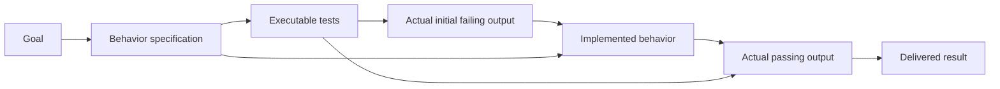

# Standalone use and method composition

Make is the dependency layer. Other methods can supply intent, domain work or
verification without becoming mandatory dependencies of this skill.

| Part | Question it answers | Typical real artifact |
|---|---|---|
| Goal | What useful result is wanted, under which constraints? | Existing brief, goal or acceptance description. |
| Specification-driven development (SDD) | What behavior and design are intended? | The selected tool's own spec, plan and task files. |
| Test-driven development (TDD) | Does the next behavior fail meaningfully before implementation and pass afterward? | Tests and actual red/green command output. |
| Make-style graph | Which required result is missing, what does it depend on, and what can happen next? | Graph definition plus existing process artifacts. |
| Host runtime | Who executes, when does work wake up, and how are interruptions controlled? | Native tools, agents, scheduling and existing execution evidence. |

## Make alone

For research, use `goal → sources → findings → report`. For a document transformation,
use `input document → transformed document → relevant rendering/checks`. Build only
the parts warranted by the actual goal. No SDD installation, software tests or new
agent platform is needed.

## Add SDD without duplicating it

If the project uses [Spec Kit](https://github.com/github/spec-kit), point a spec node
at the actual files such as `specs/<feature>/spec.md`, `plan.md` and `tasks.md`, scoped
to that feature. If it uses [OpenSpec](https://github.com/Fission-AI/OpenSpec), use
the actual change's proposal/design/tasks and relevant specification files. Confirm
the installed tool's real output layout instead of assuming every project has all
of these files. The tool owns its process and command semantics.

Bind the original files at initialization with repeated `--spec` options, for example:

```text
node <skill-dir>/scripts/make.mjs init --template software --spec openspec/changes/my-change/specs/my-capability/spec.md --spec openspec/changes/my-change/tasks.md --out .make/my-change/graph.json
node <skill-dir>/scripts/make.mjs next .make/my-change/graph.json --root . --json
```

For Spec Kit, pass the actual `specs/<feature>/spec.md`, `plan.md` and `tasks.md`
instead. You can pass a single existing acceptance file for a lightweight method.
The flag only substitutes file references; it does not detect, configure or execute
SDD tooling. Choose the relevant files rather than importing every document.

This graph links those original artifacts and the downstream deliverables. It does
not parse checklist completion as proof of software behavior, invoke slash commands,
install SDD tools or recreate their internal state machine. If no SDD tool is selected,
the software template uses a minimal `spec.md`; other templates need no spec node.

## Add TDD proportionally

The software template represents a small behavior slice:



`software.red` expects exit code `1` because the example targets Node's test runner.
That is only a mechanical check. The agent must inspect the actual assertion: an
import error or broken environment is not the desired red step. Use the project's
actual exit contract when changing the test framework. Refactor after green and
rerun the relevant tests if behavior could have changed. Do not rerun the initial
red after successful implementation simply to satisfy a phase.

Treat the template as a slice, not a mandatory document set for every edit. For a
later behavior slice, adopt a new local graph or add explicit new outputs when
retaining old red/green evidence is useful. A tiny copy edit does not need a TDD graph.

For a simple TDD workflow, keep just the acceptance cases, the project's executable
tests, actual red output, the code, and actual green output. Use the user's existing
test method and runner. The optional capture helper is one way to retain raw results;
the tests and workflow remain owned by the project. A stub's file may already exist:
read the expected red result and implement the missing behavior rather than treating
file presence as completion. If source code is refactored after green, rerun the
relevant tests. Do not modify expected results merely to make a check pass.

## Add a long-running goal loop

The host repeatedly reads the goal and artifacts, asks for the next useful work,
executes within the existing authorization and budget, then checks the result.
When context or a process is lost, a new invocation reconstructs what is available
from those same files. Completed expensive source collection can be reused.

Three independent conditions matter:

1. Artifacts are durable and accessible.
2. The host can run or wake up again and preserve cancellation, ownership and limits.
3. An agent/person continues to judge substantive quality and actual goal completion.

The skill supplies the first condition's organization and recomputation. It does not
provide a hosted worker, autonomous scheduler, infinite retries, exactly-once side
effects or a guarantee of eventual success. It can sit beside a host's persistence
or durable execution facilities; their state need not be mirrored into graph nodes.

Assign dependency-independent paths to native agents when that helps. Give each
agent the specific inputs, outputs and acceptance, then integrate actual artifacts.
Two nodes without a graph edge can still edit the same repository file or trigger
the same external action, so dependency independence alone is not safe concurrency.
